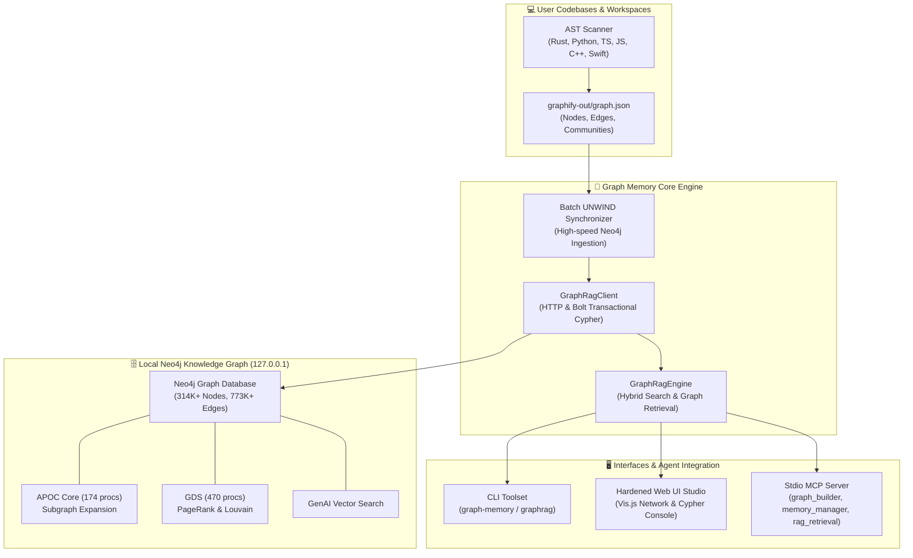

# 🕸️ Graph Memory

[](https://www.python.org/downloads/)
[](LICENSE)
[](https://neo4j.com)
[](https://modelcontextprotocol.io/)

**Graph Memory** is a production-grade, 100% local-first **Hybrid Graph RAG & Knowledge Memory Engine** designed for autonomous AI coding agents (Claude Code, Gemini Argon 4, Antigravity). It unifies AST code intelligence, native Neo4j graph acceleration (APOC, GDS, GenAI Vector), persistent episodic agent memory (`:Entity:Memory`), a hardened Web UI Studio, and Model Context Protocol (MCP) tooling.

---

## 🏛️ System Architecture



---

## ✨ Key Features

1. **Hybrid Graph RAG & Context Injection:**
   - Combines keyword/semantic search with 1-to-2 hop AST relationship traversals (`CALLS`, `IMPORTS`, `CONTAINS`, `DEFINES`).
   - Automatically synthesizes Markdown knowledge context blocks ready for LLM prompt injection.

2. **Native Neo4j Acceleration (APOC + GDS + GenAI):**
   - Out-of-the-box support for APOC subgraph extraction (`apoc.path.subgraphAll`).
   - Graph Data Science (GDS) PageRank centrality and Louvain community clustering.
   - Built-in schema constraints (`entity_id_unique`) and performance indexes.

3. **Persistent Episodic Agent Memory (`:Entity:Memory`):**
   - Enables coding agents to store design decisions, debugging insights, and architecture constraints.
   - Links memories directly to AST code entities via `[:RELATES_TO]` edges.

4. **Hardened Web UI Studio:**
   - 100% offline bundled Vis.js network visualizer (no external CDNs).
   - Built-in defenses: Anti-DNS rebinding Host validation, strict Origin verification, CSRF token authorization, and read-only Cypher write guardrails.

5. **Universal Model Context Protocol (MCP) Server:**
   - Exposes 3 standard MCP tools over stdio:
     - `graph_builder`: Multi-project AST scanner & master graph generator.
     - `memory_manager`: Store, search, and manage episodic agent memories.
     - `rag_retrieval`: Hybrid graph queries, shortest path calculation, and node explanations.

6. **Unified Dual CLI (`graph-memory` & `graphrag`):**
   - Rich CLI commands for inspecting statistics, shortest paths, communities, PageRank, and raw Cypher queries.

---

## 🚀 Quick Start

### 1. Installation

```bash
git clone https://github.com/mixox12/graph-memory.git
cd graph-memory
pip install -e .
```

### 2. Verify Graph Database Connection

Ensure your local Neo4j instance is running on `127.0.0.1:7474` (HTTP) / `127.0.0.1:7687` (Bolt):

```bash
graph-memory stats
```

*Output Example:*
```text
=================================================================
📊 Graph Memory Knowledge Engine (v1.0.0)
=================================================================
Neo4j Status:       🟢 ONLINE
Neo4j Total Nodes:  314,784
Neo4j Total Edges:  773,546
Neo4j Plugins:      APOC (174), GDS (470), GENAI (2), BLOOM (11)
-----------------------------------------------------------------
Local Graph Path:   ~/graphify-out/graph.json
Local Total Nodes:  57,394
Local Total Edges:  142,294
=================================================================
```

---

## 💻 CLI Reference

| Command | Description | Example |
|---|---|---|
| `stats` | Display node/edge counts, plugin status, and top god nodes | `graph-memory stats` |
| `query` | Execute hybrid graph & semantic search with traversal context | `graph-memory query "render_frame"` |
| `path` | Find the shortest path between two code entities | `graph-memory path "Timeline" "VideoTrack"` |
| `explain` | Deep-dive into inbound and outbound connections for an entity | `graph-memory explain "TimelineApp"` |
| `pagerank` | Display top centrality nodes by degree and PageRank | `graph-memory pagerank --top-k 20` |
| `communities` | List Louvain community clusters and their core members | `graph-memory communities` |
| `sync` | Ingest a Graphify AST `graph.json` into Neo4j in batch transactions | `graph-memory sync ~/graphify-out/graph.json` |
| `build-master` | Scan workspace projects and compile a unified master graph | `graph-memory build-master --sync` |
| `cypher` | Execute a read/write Cypher query from the terminal | `graph-memory cypher "MATCH (n:Entity) RETURN count(n)"` |
| `ui` | Launch the secured local Web UI Studio | `graph-memory ui --port 8765` |
| `mcp` | Start the stdio Model Context Protocol (MCP) server | `graph-memory mcp` |

---

## 🤖 Model Context Protocol (MCP) Configuration

To connect Graph Memory to **Claude Code**, **Antigravity**, or **Gemini CLI**, add the following entry to your MCP configuration file (e.g. `claude_desktop_config.json` or `.gemini/settings.json`):

```json
{
  "mcpServers": {
    "graph-memory": {
      "command": "python3",
      "args": ["-m", "graph_memory.mcp_server"],
      "env": {
        "NEO4J_HTTP_URI": "http://127.0.0.1:7474",
        "NEO4J_USER": "neo4j",
        "NEO4J_PASSWORD": ""
      }
    }
  }
}
```

### Available Tools:
- `rag_retrieval(mode, query, source, target, node_id, limit)`
- `memory_manager(action, content, category, entity_id, limit)`
- `graph_builder(output_path, sync_to_neo4j)`

---

## 🌐 Secured Web UI Studio

Launch the built-in local studio:

```bash
graph-memory ui --port 8765
```

Open `http://127.0.0.1:8765` in your browser.

### Security Defenses:
- **DNS Rebinding Guard:** Only requests with `Host: 127.0.0.1` or `localhost` are accepted.
- **CSRF Token Enforcement:** All POST mutations require a unique, cryptographically random session token.
- **Read-Only Cypher Shield:** Web console strictly rejects destructive queries (`CREATE`, `SET`, `DELETE`, `DROP`, `MERGE`) unless explicitly overridden.
- **Zero Remote Dependencies:** Vis.js network visualization engine is 100% locally bundled.

---

## 🧪 Running Tests

The test suite includes full security regression checks and engine unit tests:

```bash
pytest tests/ -v
```

---

## 📄 License

This project is dual-licensed under either:

* **Apache License, Version 2.0** ([LICENSE-APACHE](LICENSE-APACHE) or [http://www.apache.org/licenses/LICENSE-2.0](http://www.apache.org/licenses/LICENSE-2.0))
* **MIT License** ([LICENSE-MIT](LICENSE-MIT) or [http://opensource.org/licenses/MIT](http://opensource.org/licenses/MIT))

at your option.
